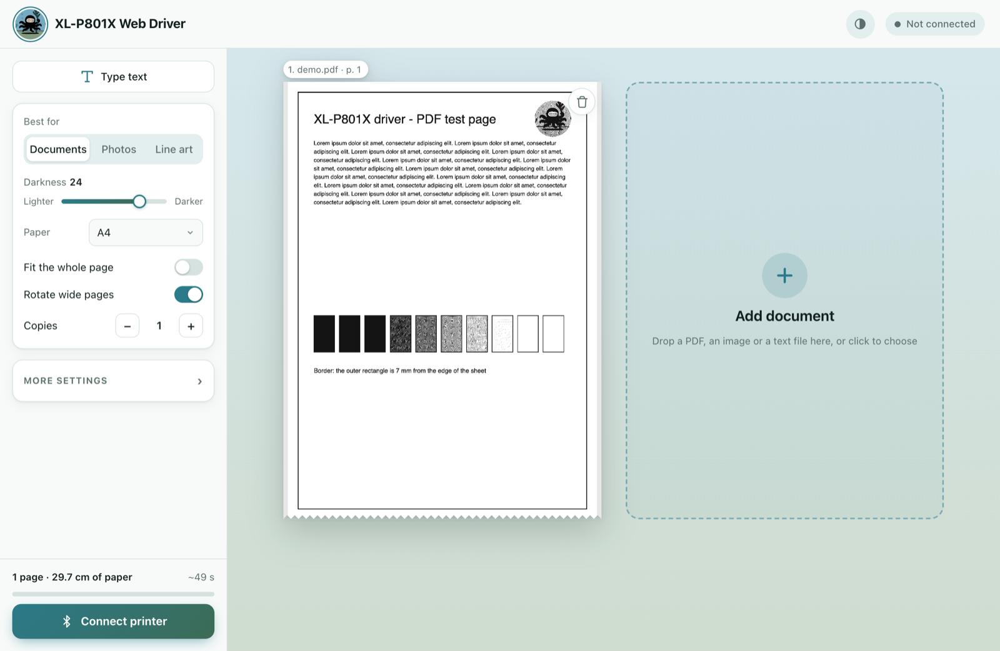
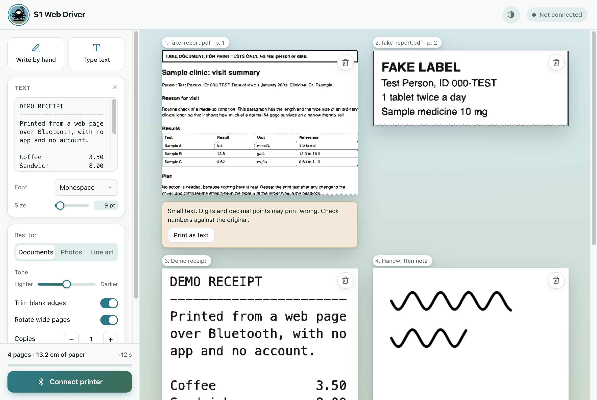

# Bring Your Own Driver

Local, open-source drivers for two Bluetooth thermal printers whose makers offer only a phone app or a closed program. The document becomes dots on the computer and goes straight to the printer over Bluetooth, with no phone, no vendor app, no account and no network.

| Printer | Folder | Drivers |
|---|---|---|
| NETUM XL-P801X, A4 | [`netum-xl-p801x/`](netum-xl-p801x/README.md) | Mac app, web page, Python command line |
| Luck Jingle S1, 48 mm | [`luck-jingle-s1/`](luck-jingle-s1/README.md) | Mac app, web page |

The drivers were built by the author with a coding agent (Claude Code), without using or decompiling the manufacturers' apps: the protocols were worked out by querying and testing the printers from the outside, and every behaviour was checked on paper. The S1 test log, [luck-jingle-s1/docs/notes.md](luck-jingle-s1/docs/notes.md), records each test in order.

## NETUM XL-P801X



## Luck Jingle S1



## Layout

Each printer's folder stands on its own, with the same shape:

```
web/        the web driver: one HTML file, with pdf.js included in web/vendor/
mac/        the native Mac app
install/    install and uninstall scripts, with a guide
docs/       protocol notes or test log, and screenshots
```

`netum-xl-p801x/xlp801/` adds the Python command line; `luck-jingle-s1/tools/` and `luck-jingle-s1/tests/` hold the test programs and the invented test documents. Each folder's README explains how to build and run its drivers.

## Status

This is a proof of concept. The drivers were tested on one unit of each printer, on one Mac (macOS 27) and one Linux computer, with invented documents only. They connect only to a printer the user picks and contain no network code.

- **S1:** the drivers use the printer's paired Bluetooth Classic serial link by default. Linux and macOS report it as encrypted (on macOS with E0, the legacy Bluetooth Classic cipher, and a 16-byte key). Bluetooth LE, which is not encrypted, is an alternative the user picks.
- **XL-P801X:** the link is Bluetooth LE without pairing, and it is not encrypted.

Using the drivers with confidential documents in a professional setting calls for an assessment proportionate to that context, including an independent review of the code and a check of the Bluetooth link where the printer is used. Known limits are listed in each folder's README.

## Article

The article *Bring Your Own Driver: Building Verifiable Print Paths for Two Bluetooth Thermal Printers with a Coding Agent* describes how these drivers were built. Link to follow.

## Licence

The code is under the [MIT licence](LICENSE). Third-party components, with their versions and licences, are listed in [DEPENDENCIES.md](DEPENDENCIES.md). The web drivers include [pdf.js](https://github.com/mozilla/pdf.js) 6.5.438 in `*/web/vendor/pdfjs/`, under its own licence (Apache 2.0, with the licence files next to it). PyMuPDF, used by the XL-P801X command line, is under the AGPL-3.0 and is installed separately with `pip`. The nestedshell logo is not covered by the MIT licence.

This project has no connection with NETUM, Luck Jingle or the makers or sellers of the printers, and none of them has reviewed or endorsed it.
