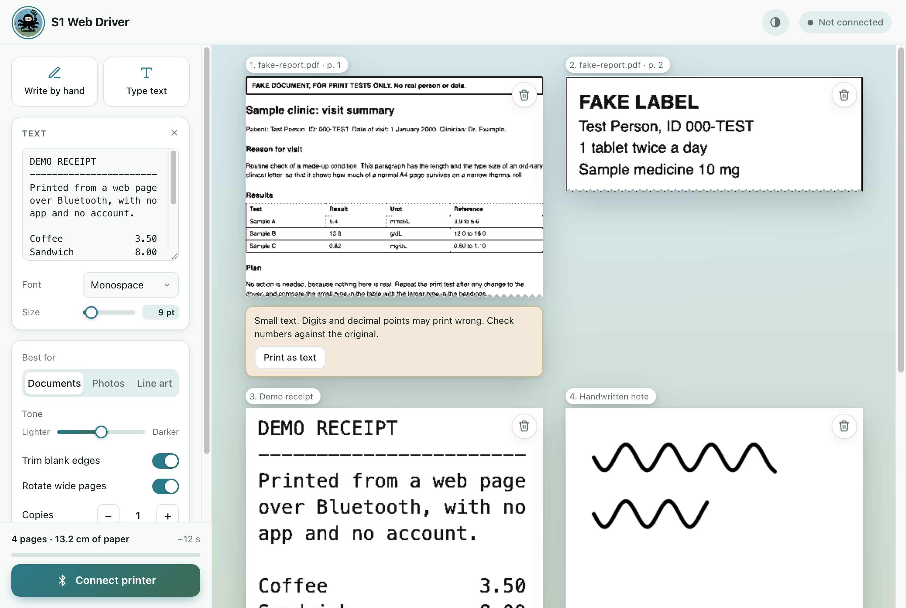
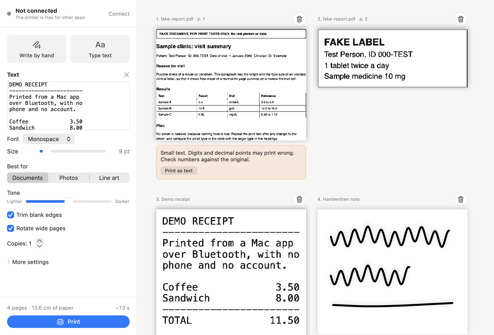
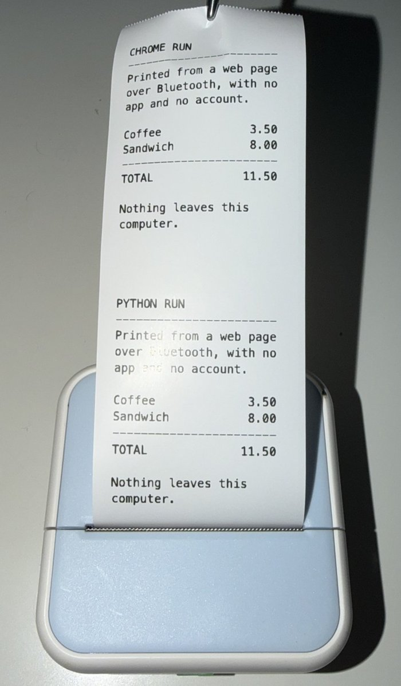

# S1 mini printer drivers

> Part of [bring-your-own-driver](../README.md). Commands are written from the repository root. The NETUM XL-P801X is in [../netum-xl-p801x/](../netum-xl-p801x/README.md).

Print on the small **S1** thermal printer (label "Type S1", Bluetooth name `PPS1_xxxx`) from a computer, with no phone, no app and no account. The drivers talk directly to the printer over Bluetooth, by one of two links:

- **Paired link (encrypted), preferred.** The printer's Classic Bluetooth serial port (`PPS1_xxxx`, Serial Port Profile). It is paired once in the computer's Bluetooth settings. On Linux the system then encrypted the link (note 43); on a Mac the system log reported encryption (E0, 16-byte key) on every connection (note 54).
- **Bluetooth LE (not encrypted), alternative.** `PPS1_xxxx_BLE`. It needs no pairing, and so it is neither authenticated nor encrypted. The drivers never switch to it by themselves: the user picks it.

On Linux the kernel listed the paired serial link as authenticated and encrypted and the LE link as neither, and a test strip sent over the serial link printed ([docs/notes.md](docs/notes.md), note 43). The web page has since printed over the serial link on Linux, as an image and as text, seen on paper (note 46), and from Chrome on a Mac (note 52). The Mac app has printed over it, including a Stop during a job of three copies (notes 59 and 60). On a Mac, Chrome opens the paired link once per start of the browser (note 63); the Mac app has no such limit.

There are two drivers:

- **Web page** (`web/index.html`): one HTML file that uses Web Serial for the paired link and Web Bluetooth for LE. It works in Chrome or Edge and installs nothing.
- **Mac app** (`mac/`): a native app that also adds **Print on S1** to the PDF menu of every print dialog.



Both have the same controls: add a PDF, an image or a text file, type text, or write a note by hand. Check the preview, then print. A print can be stopped while it runs.





## Use the web page

```sh
luck-jingle-s1/serve.sh
```

Open <http://localhost:8802> in Chrome or Edge.

- **Connect (paired, encrypted)** opens the browser's list of Bluetooth serial ports: pick the printer, `PPS1_xxxx`. Other paired devices with a serial port are in the same list. A port allowed once is used again without the list, unless the last attempt failed; **Choose another serial port** always shows the list, with every serial port of the computer.
- **On a Mac** (Chrome 157 on macOS 27.0.1, note 63) the paired link has limits that come from the system:
  - the first connection takes about 10 seconds: Chrome's first attempt to open the port ends after 10 seconds, and the page tries a second time, which succeeds at once;
  - after a **Disconnect**, connecting again worked 3 seconds later. After a longer pause it fails, and Chrome then keeps the printer busy until it is quit: quit Chrome, open it again and connect. The Mac app does not have this limit;
  - do not pick `cu.PPS1_xxxx` under **Choose another serial port**: that system device reaches the printer only the first time it is opened after a pairing (note 58).
- **Use Bluetooth LE instead (not encrypted)** opens the Web Bluetooth list of devices whose name starts with `PPS1` or `S1_`.

Nothing connects by itself: the browser lists the devices, and you pick one. The footer says which link is in use. Over the paired link the printer has sent no `OK` so far, so a finished job says "Sent… check the paper" rather than "Printed". Web Serial and Web Bluetooth need `localhost` or HTTPS, so the file also works from any HTTPS host, but not when opened directly from disk.

Unplug the USB cable first. In the one case seen, the printer did not answer over Bluetooth while the cable was connected.

### Pair the printer once

For the encrypted link, pair the printer in the computer's Bluetooth settings (on a Mac: **System Settings › Bluetooth**), with the printer switched on. Pair `PPS1_xxxx`, not `PPS1_xxxx_BLE`. On Linux this pairing was already in place and how it was made is not recorded; on a Mac it was made there, and the system log shows a pairing with a confirmation value accepted on the Mac (note 54). The pairing probably needs no confirmation on the printer, so it does not protect against someone interfering at the moment of pairing (not checked).

## Use the Mac app

```sh
luck-jingle-s1/mac/build.sh               # needs only the Xcode Command Line Tools
luck-jingle-s1/install/Install.command    # copies the app to ~/Applications and adds the print-dialog entry
```

No administrator password is needed. See [install/GUIDE.md](install/GUIDE.md) for use, troubleshooting and removal.

- **Choosing the printer.** The app never connects to a printer by itself. On first launch the status area lists the printers it finds: the paired serial ports of an S1 first (marked *recommended*), then the S1 printers seen over Bluetooth LE. Press **Connect** next to one. The app remembers that printer and, on later launches, connects only to it. **Change printer** forgets it and shows the list again. While on Bluetooth LE, **Use the paired link instead** appears when the same printer is also paired (`PPS1_4367` for `PPS1_4367_BLE`). The status area shows the link in use: *Paired link (encrypted)* or *Bluetooth LE (not encrypted)*.
- **Files from the print dialog** (and files dropped on the Dock icon) open in the window with their preview and wait for **Print**. With **Print files from the print dialog at once** on, under **More settings**, they print without pressing Print, except a document with a small-text warning, which still waits so the warning can be read first.

## Which driver to choose

| | Web page | Mac app |
|---|---|---|
| Runs on | Chrome or Edge with Web Serial or Web Bluetooth | macOS 13 or later (build target) |
| Tested on | Chrome 156 on macOS 27.0.1, over Bluetooth LE; Chrome 158 on Linux, over the paired link | macOS 27.0.1, over the paired link and over Bluetooth LE |
| Not available on | Safari, Firefox, iPhone, iPad | Windows, Linux |
| Not tested on | Android, Windows, ChromeOS | macOS versions before 27 |
| Print from other apps | No | Yes, from the PDF menu of the print dialog. Tried by the author and it printed; not yet tried with a real label or practice-management program |
| Files | PDF, images, TXT, MD, CSV, LOG | The same, plus RTF |
| Network | Loads nothing from the internet: pdf.js is served from `web/vendor/`. Its content security policy sets `connect-src 'none'` for the page; the pdf.js worker is a separate file that the policy does not cover | Contains no network code |

## What the drivers send

Only standard ESC/POS printing commands and one read-only query:

| Bytes | Meaning |
|---|---|
| `1D 76 30 00 30 00 hL hH` + rows | Raster image: 48 bytes per row, 384 dots, 1 = black, left dot in the top bit |
| `1B 4A n` | Feed `n` rows |
| `10 FF 50 F1` | Read the battery level (reply `00 <percent>`) |

They never send a reset, a density change, a setting change or a firmware update.

Over BLE, the printer uses service `FF00`: replies on `FF01` (`OK` once a job is taken), data on `FF02`, and flow control on `FF03` (`01 n` grants `n` packets, `02 lo hi` sets the packet size, 200 bytes here). It advertises no service UUID, so the drivers list devices whose names start with `PPS1` or `S1_`, and connect only to the one the user picks.

Over the paired serial link (RFCOMM channel 1, service class `0x1101`) the same bytes go as a plain stream. RFCOMM has its own flow control, so there are no credits. The battery query answered `00 4d`; no `OK` came within 4 s of a 128-row raster. The drivers write in chunks of 512 bytes, wait for the port to take each one, and treat a job as sent but unconfirmed unless an `OK` arrives within 3 s. A stop finishes the current page, drops the pages and copies still to come, and then sends the final feed: a write ends when the system has the bytes, not when the printer has them, so a page cut short could leave the printer inside a raster that swallows what follows (note 47).

## Printer behaviour the drivers rely on

These come from test prints on one printer: model `S1_LYiN48D_GY`, firmware `V1.9.11`. Other units or firmware may behave differently. The full log is in [docs/notes.md](docs/notes.md).

- **One raster command per page.** The printer moved the paper about 6 mm when one raster ended and the next started in a new packet, which left white gaps in the print.
- **Pauses inside a raster are safe.** Pauses of up to 1 s left no gap.
- **Stopping needs no disconnect.** An unfinished raster was still open after 1 s and gone after 3 s, so over BLE the drivers stop sending, wait 3.5 s, and only then send the final feed. They stop at the next blank row, up to 8 mm away, so a line of text is not cut in half. Over the paired link they finish the page instead (see above).
- **20 mm of paper after the last line** is the default **Feed after**; with 10 mm the last lines stayed behind the tear bar (note 46). The feed is sent as blank rows in a raster: an `ESC J` sent right after a raster left the paper where it was (note 50).
- **Credits are strict.** A driver that gets no more credits reports an error and sends nothing further.
- **Speed** is about 4.2 kB/s, or about 10 mm of paper per second.
- **The printed area** is 384 dots. The first and last dots both print. 8 dots per mm is assumed from 203 dpi and has not been measured with a ruler.

## Known limits

- Shaded areas print darker than the preview, and a dark screenshot came out nearly solid black. Use **Tone** to lighten them.
- **Do not trust small numbers from a shrunk A4 page.** A full A4 page shrinks to 48 mm wide. In a fake report, `0.60 to 1.10` came out as `0.60 to 1 10` and `13.8` became hard to tell from `12 9`. Check numbers against the original, and do not rely on these prints for clinical values.
- **Both drivers warn on PDF pages with type under 14 dots per em**, the size below which two digits can differ by 3 dots or fewer. Images are not checked, because their text cannot be measured. A warned page with real text offers **Print as text**, which prints the words at 8 pt. On the fake page all the numbers came out right on paper, at the cost of more paper (14 cm instead of 4). It loses the layout, and tables may not line up in other documents.
- The margins looked about 1 mm wider on the right than on the left on the one unit measured, from a photo.
- Not tested: what happens when the paper runs out, and touch or pen input on the handwritten note.
- Not tested over the paired serial link: Stop from Chrome on a Mac.

## Tests

```sh
luck-jingle-s1/mac/test.sh              # Mac app: job bytes, stopping, layout, desk behaviour. No printer needed.
luck-jingle-s1/mac/tools/real_print.sh  # Mac app on the real printer. Uses a few centimetres of paper. Add "ble" to use Bluetooth LE.

node luck-jingle-s1/tools/tests/send.test.mjs     # web page: Bluetooth LE protocol against a simulated printer
node luck-jingle-s1/tools/tests/serial.test.mjs   # web page: paired-link (Web Serial) code against a fake serial port

D=$(mktemp -d) && swiftc luck-jingle-s1/tools/digit_separation.swift -o "$D/digit_separation" && "$D/digit_separation"   # figures behind the small-type warning
```

`luck-jingle-s1/tools/tests/ui.browser.mjs` checks the page in a browser. It needs `luck-jingle-s1/serve.sh` running and Chrome started with `--remote-debugging-port=9333 --user-data-dir="$(mktemp -d)"`: a throwaway profile, never your everyday one, because the debugging port gives any local program control of the browser. The Python scripts in `luck-jingle-s1/tools/` are the probes and test prints from the discovery work. All test documents are fake.

## Article

The article that describes how these drivers were built is linked from the [main README](../README.md#article).

## Background

This project has no connection with Luck Jingle or the maker or sellers of the printer, and none of them has reviewed or endorsed it. It does not use the Luck Jingle app or its services, and it contains no code, logos, icons or fonts from them. The tools talk only to the printer.

The command set was first learned from the public notes of [S1Print](https://github.com/MarvinQuevedo/s1print) and [minixprint](https://github.com/SwapnanilDhol/minixprint), then each command was confirmed on this printer. No code was copied from either project. See [docs/notes.md](docs/notes.md) for the provenance of each finding.
