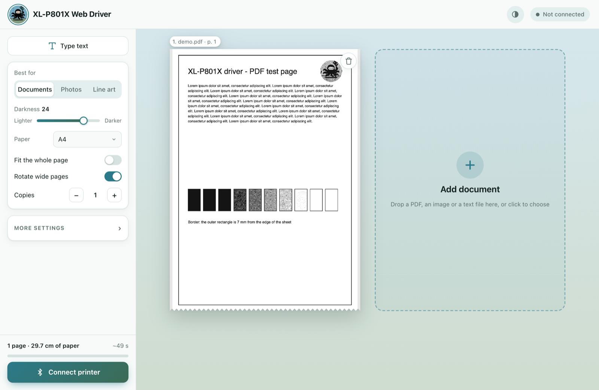

# XL-P801X driver

> Part of [bring-your-own-driver](../README.md). Run the commands below from this folder. The S1 mini printer is in [../luck-jingle-s1/](../luck-jingle-s1/README.md).

Print from a Mac on the **NETUM XL-P801X** portable A4 thermal printer (made by Guangzhou Netum
Electronic), which otherwise only works from the vendor's phone app. The project talks to the printer
directly over Bluetooth LE. The protocol was reverse engineered and is documented in
[docs/PROTOCOL.md](docs/PROTOCOL.md).

It has three front ends that share the same protocol:

- **Mac app** (`mac/`): drop files on it to preview and print them. It also adds **Print on XL-P801X** to the PDF menu of
  every print dialog, without a kernel driver, a signed driver package or an admin password.
- **Web app** (`web/`): a single HTML page using Web Bluetooth. You can drop in PDFs, images or text, see an exact
  dot-for-dot preview, and print.
- **Command line** (`xlp801/`): a Python package built on [bleak](https://github.com/hbldh/bleak), for scripts and automation.



## Mac app

Download `XL-P801X-macOS.zip` from the [releases page](https://github.com/nestedshell/bring-your-own-driver/releases) (or build it, below), unzip it, right-click `Install.command` and choose **Open**.
[install/GUIDE.md](install/GUIDE.md) is the full guide: install, use, uninstall and troubleshooting.

- The first time, choose the printer: the status area lists the XL-P801X printers it finds, and **Connect** next to one
  connects to it. The app remembers it and connects only to that printer; **Change printer** chooses again. It never
  connects to a printer by itself. The link is Bluetooth LE without pairing, so it is not encrypted: do not print confidential documents where others may be within Bluetooth range.
- Drop PDFs, images, text or RTF files on the window or on the Dock icon, or send them from the print dialog. They open
  with their preview and wait for **Print**. Turn on *Print files at once when dropped or sent from the print dialog*
  to print them without pressing Print.
- From any app, choose **File › Print… › PDF ▾ › Print on XL-P801X**.
- **Paper** picks the output size: A4 (default), Letter, A5, A6, or 80/57 mm rolls. The page is scaled to that width and
  centred on the print head. On an A4 roll, A5 prints a smaller, centred page. Narrower paper must sit in the middle of the guide.
- To uninstall, run `Uninstall.command`, or delete `~/Applications/XL-P801X Print.app` and
  `~/Library/PDF Services/Print on XL-P801X.app`.

To build it yourself you need only the Command Line Tools, not Xcode:

```sh
mac/build.sh     # → dist/XL-P801X/ (app + install scripts + guide) and dist/XL-P801X-macOS.zip
```

## Web app

Web Bluetooth works in **Chrome or Edge**. It does not work in Safari or Firefox. The page must be served from `localhost` or HTTPS:

```sh
./serve.sh            # → http://localhost:8801
```

1. Switch the printer on. If the phone app is connected to it, close the app.
2. Click **Connect printer** and pick `XL-P801X_…_LE`.
3. Drop a PDF, image or text file, or paste an image with ⌘V. **Type text** adds text of your own.
4. Pick the **Paper** size (A4 by default; Letter, A5, A6 and 80/57 mm rolls). Adjust **Darkness** and **Best for** while you
   watch the preview, then click **Print** or press ⌘P.

Settings are remembered between sessions. **More settings → Add calibration page** prints a ruler across the whole
print head, so you can check the sheet offset.

## Command line

Needs Python 3.11 or later (see [DEPENDENCIES.md](../DEPENDENCIES.md)).

```sh
python3 -m venv .venv && .venv/bin/pip install -r requirements.txt

.venv/bin/python -m xlp801 document.pdf                 # all pages
.venv/bin/python -m xlp801 document.pdf -p 1-2 -d 28    # pages 1-2, darker
.venv/bin/python -m xlp801 photo.jpg --dither atkinson
.venv/bin/python -m xlp801 notes.txt
.venv/bin/python -m xlp801 document.pdf --preview out.png   # render only, no printing
```

| Option | Default | |
|---|---|---|
| `-d, --density` | 24 | heat level 0–31 |
| `--dither` | `auto` | `auto` (crisp text, dithered greys), `floyd`, `atkinson`, `threshold` |
| `--paper` | `a4` | `a4`, `letter`, `a5`, `a6`, `80mm`, `57mm`: content is scaled to that width and centred |
| `-p, --pages` | all | PDF pages, e.g. `1-3,5` |
| `-m, --margin` | 0 | extra margin in mm |
| `-c, --copies` | 1 | |
| `--shift` | 0 | move the print right (+) or left (−) in mm, if the paper is not centred |
| `--address` | first found | BLE identifier of a specific printer |

The first time you run it, macOS asks to allow Bluetooth for your terminal app.

## Notes

- One full A4 page takes about 48 s (about 10.7 kB/s). The limit is the rate at which the printer returns flow-control credits; printing through the vendor app was not timed.
- The printer has no built-in fonts. Everything, including text, is rendered on the Mac and sent as an image.
- The default darkness after power-on is faint. The driver sets level 24 at the start of every job.

## Layout

```
xlp801/protocol.py   commands, geometry, job builder
xlp801/ble.py        BLE transport with credit flow control
xlp801/render.py     PDF / image / text → 1-bit rows
xlp801/cli.py        command line
mac/Sources/         Mac app (SwiftUI + CoreBluetooth + PDFKit)
mac/build.sh         builds the universal, ad-hoc signed app and the release zip
install/             Install.command, Uninstall.command, GUIDE.md (shipped in the release zip)
web/index.html       web app (no build step)
docs/PROTOCOL.md     reverse-engineered protocol
```

## Article

The article that describes how these drivers were built is linked from the [main README](../README.md#article).
